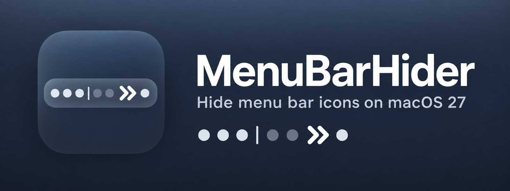
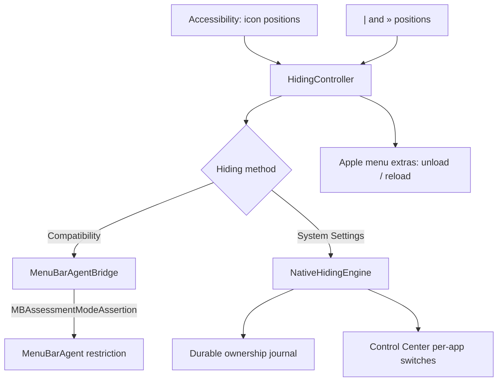

<p align="center">
  
</p>

<p align="center">
  <a href="https://github.com/happy666End/MenuBarHider/releases"></a>
  
  <a href="LICENSE"></a>
</p>

<p align="center">
  
</p>

**MenuBarHider** hides menu bar icons on macOS 27. Put the icons you want to hide
between `|` and `»`, then click `»` to collapse or expand them. An optional timer hides
them again after use.

```text
  [always visible]  |  [hidden]  »  [always visible]      expanded
  [always visible]  »  [always visible]                    collapsed
```

There are two hiding methods:

| Method | How it hides apps | Permissions |
|---|---|---|
| Compatibility (default) | A temporary `MenuBarAgent` visibility restriction | Accessibility |
| System Settings (Experimental) | The system's per-app menu bar switches | Accessibility and access to one Control Center folder |

Neither method requires Screen Recording or Full Disk Access. The app does not capture
screenshots of your menu bar or collect telemetry. Both methods use private macOS
interfaces and may need updates when macOS changes.

## Install

Requires macOS 27.0 or newer. Download `MenuBarHider-x.y.z.dmg` from the
[latest release](https://github.com/happy666End/MenuBarHider/releases/latest), open it and
drag **MenuBarHider.app** onto **Applications**. A ZIP download is also available.
Official release downloads are signed with a Developer ID and notarized by Apple.

Run the app from `/Applications`. If you launch it from the disk image or Downloads,
it offers to move itself and leaves hiding disabled until then.

On first launch, grant **Accessibility** in **System Settings → Privacy & Security →
Accessibility**. The app detects the grant within two seconds; no restart is needed.
Compatibility works with this permission alone. The experimental method asks for its
folder access separately, as described below.

## Use

1. ⌘-drag the `»` separator to the right of the icons you want to hide.
2. While expanded, ⌘-drag `|` to the left of that group. Icons outside the two separators
   stay visible.
3. Click `»` to hide or show the group. Set **Auto-hide After** to collapse it after a
   delay, or choose **Never** to control it yourself.

The app scans the layout each time you hide the group. Reorder icons while expanded,
then hide them again to use the new layout. Apps launched while collapsed stay visible
until the next layout scan places them inside the hidden group.

Right-click either separator for the menu:

| Item | What it does |
|---|---|
| Show Hidden Items / Hide Items | Same as a left click |
| Rescan Layout | Re-read which icons sit between `\|` and `»` |
| Auto-hide After | Never, 5 seconds, 10 seconds, 30 seconds, or 1 minute |
| Hiding Method | Choose Compatibility or System Settings (Experimental) |
| Allow Access to Menu Bar Settings… | Inside Hiding Method; grant access to the Control Center folder |
| Restore Menu Bar Visibility | Retry restoration and keep items shown; appears for the experimental method or after an error |
| Launch at Login | Start the app at login through `SMAppService` |

## Hiding methods

### Compatibility

The default method asks `MenuBarAgent` to show an allow-list of system items and app
bundle identifiers. It uses `MBAssessmentModeAssertion` from the private
`MenuBarClientCore.framework`; releasing the assertion removes the restriction.

macOS also uses this restriction for assessment mode, where Notification Center is
blocked. MenuBarHider temporarily lifts it while the pointer is over the clock's click
target on either display, then reapplies it half a second after the pointer leaves.
Hidden app icons therefore appear while you hover over the clock. Apple menu extras
stay hidden during this workaround.

If the required framework or class is unavailable, the menu reports **Hiding unavailable
on this macOS build**.

### System Settings (Experimental)

Choose **Hiding Method → Allow Access to Menu Bar Settings…**, then select only:

```text
~/Library/Group Containers/group.com.apple.controlcenter
```

This is folder access, not Full Disk Access. Accessibility is still required to read
icon positions. An access or format error leaves the selected method unchanged.
Granting access selects the experimental method and keeps icons shown until you
explicitly hide them.

This method changes macOS's persistent per-app menu bar switches. It does not activate
an assessment restriction or use the clock-hover workaround. It is optional;
Compatibility remains the default.

The app records each switch in a durable recovery journal before disabling it, then
reads the settings back to check the change. **Show Hidden Items**, normal quit, and the next launch
restore the switches the app owns using the current settings. Apps that were already
disabled remain disabled, and unrelated settings are preserved. Entries without a
usable bundle identifier are left untouched.

If restoration fails, the app keeps the journal, reports the error and blocks further
hiding or a method change. It does not silently fall back to Compatibility. Use
**Restore Menu Bar Visibility** to retry. If normal quit cannot restore the switches,
the app offers to keep running for another attempt. After a forced quit or crash,
restoration waits for the next launch, so reopen the app before removing it.

Two icons controlled by one system switch cannot be split between visible and hidden
sections; use Compatibility for that layout. Apps not yet registered in macOS's menu
bar settings cannot be hidden with this method. Apple's preference data has no public
transactional API: simultaneous edits in System Settings, or manually disabling an
already managed switch again, cannot always be distinguished from the app's changes.

## How it works



The scanner reads app icon positions, including Apple agents such as the input menu,
from each app's `AXExtrasMenuBar`; the
separators are MenuBarHider's own `NSStatusItem`s. If scanning an app fails, its icons
keep their previous hidden or visible state.

Time Machine, VPN and other Apple menu extras use the same separate mechanism with
both hiding methods. They are plugins loaded into `SystemUIServer`, which does not
expose a distinct bundle identifier for each extra. MenuBarHider unloads selected
extras through private `CoreMenuExtra` calls in HIServices and loads them back when
shown. Their order in `SystemUIServer` is used to match them to their positions.

### Apple menu bar items

Compatibility also follows separator positions for Wi-Fi, Bluetooth, battery, display,
sound, keyboard brightness and screen mirroring. These controls share `MenuBarAgent`,
so they are identified separately from app bundle identifiers. The clock and Control
Center always stay visible. Unknown system controls are left visible; an incomplete
scan preserves previous selections.

Apple agents with their own status items, including the input menu, are scanned like
other apps. System Settings can hide registered Apple applications with their own
per-app switch. For unregistered Apple agents and system controls, it shows an error
before preferences or Apple plugins change. Choose Compatibility for that layout;
MenuBarHider never switches methods automatically.

## Recovery and limitations

- A hidden Apple menu extra is unloaded, so System Settings shows it as off until it
  is restored. The app reloads it on show, normal quit, and the next launch after a
  crash. If the app is removed while an extra is hidden, turn the extra back on in
  System Settings.
- In Compatibility, items without a bundle identifier cannot be allow-listed. macOS
  also ignores allow-list entries for apps launched outside `/Applications`, including
  `~/Applications`. Those items may remain hidden while the restriction is active.
- Clock hover detection covers multiple displays. Separator positions are measured on
  the primary display.
- Private interfaces can change in any macOS update. Errors are shown in the menu;
  the experimental method retains pending recovery information until restoration
  succeeds.

## Build from source

Development uses Xcode 27 with the macOS 27 SDK and
[xcodegen](https://github.com/yonaskolb/XcodeGen).

```bash
brew install xcodegen
git clone https://github.com/happy666End/MenuBarHider.git
cd MenuBarHider
make build
```

The app is built at `build/Build/Products/Release/MenuBarHider.app`. To install it in
`/Applications`, quit MenuBarHider normally and run `make install`. The developer
installer requires Python 3, available with the Xcode command-line developer tools;
the app itself has no Python dependency.

The installer refuses a running app or an unreadable, malformed, or pending recovery
journal. It verifies the new build, keeps a backup of the installed app with an
executable checksum, and replaces it atomically with rollback on failure. The backup
path is printed. Open the installed app yourself when ready.

Source builds are ad-hoc signed by default. A rebuild may change the signature and
require a fresh Accessibility grant. To use your Apple developer certificate:

```bash
make build SIGN_IDENTITY="Developer ID Application" TEAM=XXXXXXXXXX
```

You can put `SIGN_IDENTITY` and `TEAM` in the git-ignored `local.mk`.

## Development

```bash
make gen      # generate the Xcode project; project.pbxproj is not committed
make test     # run app-hosted unit tests; this can launch the test host
make lint     # run SwiftLint and xcrun swift-format
make build    # build Release into build/
make install  # verify and install in /Applications; keep a backup, do not launch
```

Install SwiftLint with `brew install swiftlint` to run `make lint`. Formatting settings
are in `.swift-format`. Installer fixtures run in temporary directories with mocked
process and signing commands:

```bash
python3 -m unittest discover -s scripts/tests -p 'test_*.py'
```

To prepare downloadable release files, configure a Developer ID Application
certificate, your Apple team ID, and a `notarytool` keychain profile named
`notary-profile` (or set `NOTARY_PROFILE`). Then run:

```bash
make release TEAM=XXXXXXXXXX
# To select a specific certificate:
make release TEAM=XXXXXXXXXX SIGN_IDENTITY="Developer ID Application: Your Name (XXXXXXXXXX)"
```

`make release` defaults to Developer ID signing. The script requires accepted
notarization, validates stapled tickets, and runs Gatekeeper assessments before moving
the completed files into `dist/<version>/`. Existing distributions are preserved; an
existing output directory for the same version stops the build. Failed attempts retain
their diagnostics in a temporary release directory under `dist/`.

Upload only the versioned ZIP, DMG and `SHA256SUMS` to a GitHub release. Build and
notarization logs are local diagnostics.

## License

[MIT](LICENSE). The full license is also included in the app's resources.
